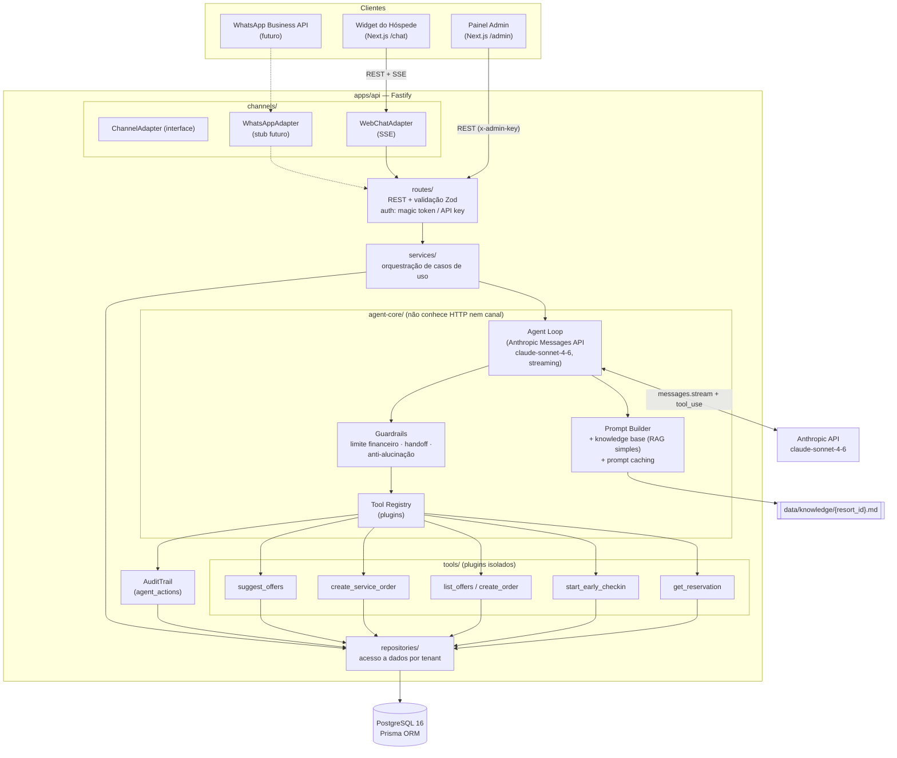
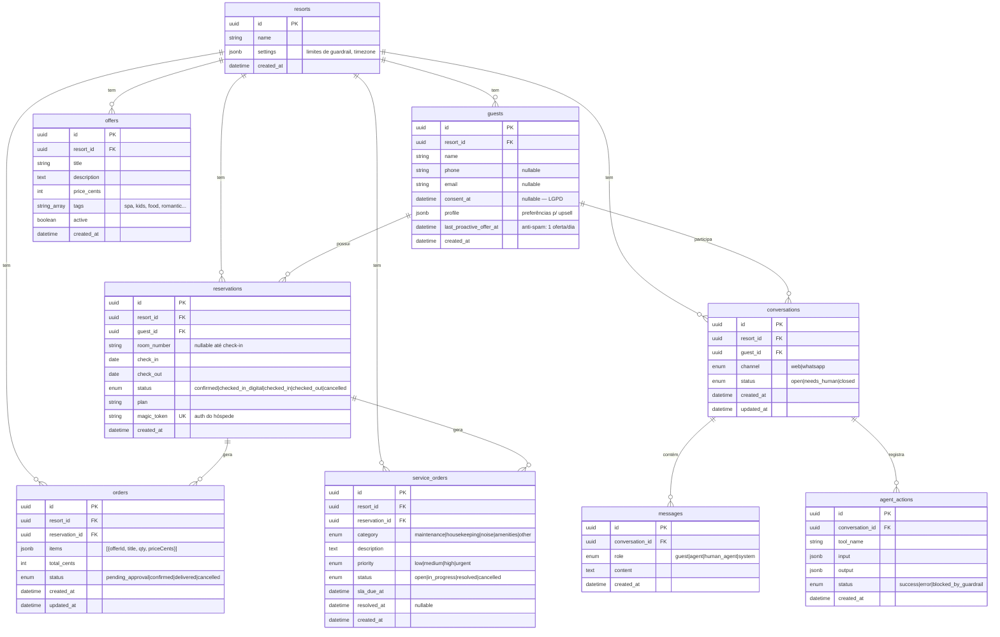

# Agente Concierge — Arquitetura (MVP)

> **Status:** Fase 0 — aguardando aprovação antes de qualquer código.
> **Objetivo:** chatbot de IA multi-tenant para resorts que acompanha o hóspede em toda a jornada (pré-estadia → check-in → estadia → reclamações → pós-estadia), gera upsell contextual e reduz carga de atendimento humano.

---

## 1. Diagrama da Arquitetura



**Fluxo de uma mensagem do hóspede (caminho crítico):**

1. `POST /api/conversations/:id/messages` chega pelo `WebChatAdapter` (SSE aberto na resposta).
2. A rota valida com Zod, autentica o magic token e delega ao `ConversationService`.
3. O service persiste a mensagem do hóspede e invoca o **agent-core** com um contexto neutro de canal (`AgentContext`: resort, hóspede, reserva, histórico).
4. O agent loop monta o prompt (system + knowledge base cacheados), chama a Anthropic API com streaming e as tools registradas.
5. Cada `tool_use` passa pelos **guardrails** → executa o handler → grava em `agent_actions` → resultado volta ao modelo.
6. Deltas de texto e eventos estruturados (cards de oferta/pedido) fluem pelo `ChannelAdapter` até o widget via SSE.
7. Ao final, a resposta completa do agente é persistida em `messages`.

---

## 2. Decisões Técnicas (ADRs curtos)

### ADR-001 — Monorepo pnpm workspaces + Turborepo
**Decisão:** `apps/api`, `apps/web`, `packages/shared`.
**Justificativa:** tipos e schemas Zod compartilhados entre API e front eliminam drift de contrato (o schema que valida a request é o mesmo que tipa o client). Turborepo dá cache de build/test e pipelines (`build` do shared antes dos apps). Escala para novos pacotes (`packages/whatsapp-adapter`, `packages/agent-evals`) sem reestruturar.

### ADR-002 — Fastify + Zod em todas as entradas
**Decisão:** Fastify com `fastify-type-provider-zod`; todo body/query/params validado por schemas vindos de `packages/shared`.
**Justificativa:** Fastify tem suporte nativo a SSE via `reply.raw`, plugins encapsulados (auth por escopo de rota) e é ~2× mais rápido que Express. Zod na borda garante que o core nunca recebe dado malformado — e os mesmos schemas geram os tipos das tools do agente (fonte única de verdade).

### ADR-003 — PostgreSQL 16 + Prisma, migrations desde o commit inicial
**Decisão:** Prisma ORM com migrations versionadas; JSONB para dados semiestruturados (`settings`, `profile`, `items`, `input`/`output` de auditoria).
**Justificativa:** Postgres cobre relacional + JSONB + (futuro) `pgvector` para RAG real sem trocar de banco. Prisma dá tipos gerados que fluem até o shared. Migrations versionadas desde o dia 1 evitam o "drift de schema" clássico de MVP.

### ADR-004 — Anthropic API com tool use nativo e loop agêntico próprio
**Decisão:** SDK oficial `@anthropic-ai/sdk`, modelo `claude-sonnet-4-6`, `client.messages.stream()` com loop manual de tool use (não o Tool Runner beta).
**Justificativa:** o loop manual é necessário porque **cada** `tool_use` precisa ser interceptado antes de executar: (a) checagem de guardrails (limite financeiro → `pending_approval`), (b) gravação em `agent_actions`, (c) persistência incremental. O loop é ~40 linhas e nos dá controle total + zero dependência de API beta. Detalhes que respeitamos por contrato da API: tool inputs sempre parseados como JSON (nunca string-match), todos os `tool_result` de uma rodada voltam numa única mensagem `user`, tool com falha retorna `is_error: true` (o modelo se recupera com elegância), e **prompt caching** no system prompt + knowledge base (`cache_control: ephemeral`) corta ~90% do custo de input em conversas multi-turno. Sem prefill de assistant (não suportado no claude-sonnet-4-6) — formato de saída é controlado por prompt.

### ADR-005 — SSE para streaming (não WebSocket)
**Decisão:** a resposta do agente é streamada por Server-Sent Events na própria resposta do `POST .../messages`.
**Justificativa:** o fluxo é unidirecional (servidor → cliente); SSE funciona sobre HTTP/1.1 puro, atravessa proxies/CDNs sem upgrade de protocolo, reconecta nativamente (`EventSource`) e não exige infra de socket com estado. WebSocket só se justificaria com bidirecionalidade em tempo real (digitação colaborativa etc.), que não temos. Eventos tipados (`text_delta`, `tool_started`, `card`, `done`, `error`) definidos em `packages/shared`.

### ADR-006 — Padrão Channel Adapter
**Decisão:** interface `ChannelAdapter` (recebe mensagens normalizadas do canal, emite eventos do agente para o canal). `WebChatAdapter` hoje; `WhatsAppAdapter` depois.
**Justificativa:** o agent-core produz um stream de `AgentEvent`s neutro. O adapter traduz: no web vira SSE; no WhatsApp virará chamadas à Business API (com buffering, já que WhatsApp não streama). Adicionar canal = implementar 1 interface + 1 rota de webhook. Zero mudança no core.

### ADR-007 — Tools como plugins auto-registráveis
**Decisão:** cada tool é um módulo `tools/<nome>/` exportando `{ name, description, inputSchema (Zod), guardrail?, handler }`. O registry converte Zod → JSON Schema (via `zod-to-json-schema`) e monta o array `tools` da chamada à Anthropic.
**Justificativa:** registrar tool nova = criar pasta + adicionar 1 linha no índice do registry. O core itera o registry; não conhece nenhuma tool individualmente. Cada tool tem teste unitário próprio com handler mockável (repositories injetados via contexto).

### ADR-008 — Multi-tenant por coluna `resort_id` (row-level scoping)
**Decisão:** todas as tabelas de negócio carregam `resort_id`; os repositories **exigem** `resortId` em toda query (imposto por tipo — não existe método sem ele).
**Justificativa:** um deploy, N resorts, custo operacional mínimo. Schema-per-tenant ou DB-per-tenant são overkill no MVP e migram depois sem reescrita porque o scoping já está isolado na camada de repositories. Limites de guardrail por resort vivem em `resorts.settings` (JSONB validado por Zod).

### ADR-009 — Guardrails em três camadas
**Decisão e justificativa:**
1. **Financeiro (determinístico, no código):** `create_order` compara `total_cents` com `settings.orderAutoApproveLimitCents` do resort. Acima do limite → pedido nasce `pending_approval` e o agente informa o hóspede que precisa de confirmação da equipe. Nunca delegado ao modelo — regra de dinheiro é código, não prompt.
2. **Handoff humano:** detecção híbrida — (a) tool `escalate_to_human` disponível ao modelo (instruído a usá-la diante de frustração ou pedido explícito) + (b) heurística de palavras-chave no service como rede de segurança. Conversa vira `needs_human`, destacada no painel; o agente para de responder até um humano liberar.
3. **Anti-alucinação:** system prompt exige que dados factuais (reserva, preços, horários) venham **somente** de tool results ou da knowledge base; se a tool falhar ou não retornar, o agente diz que vai verificar com a equipe. Tool com erro retorna `is_error: true` — nunca quebra a conversa.

### ADR-010 — RAG simples por arquivo Markdown + prompt caching
**Decisão:** `data/knowledge/{resort_id}.md` carregado integralmente no system prompt, com breakpoint de `cache_control` após o conteúdo estável.
**Justificativa:** uma base de conhecimento de resort tem ~5–15k tokens — cabe no contexto com folga e o caching torna o custo marginal desprezível (leitura de cache ≈ 0.1× do preço). Vector DB agora seria complexidade sem ganho. O caminho de evolução (interface `KnowledgeProvider` → implementação `pgvector`) fica documentado no README.

### ADR-011 — Autenticação simples, estruturada para troca
**Decisão:** hóspede autentica via **magic token** opaco ligado à reserva (`reservations.magic_token`, passado como `?token=`); admin via `x-admin-key` (env var por ambiente). Ambos implementados como plugins Fastify (`guestAuth`, `adminAuth`) que populam `request.auth`.
**Justificativa:** rotas nunca leem token diretamente — só `request.auth.{resortId, guestId, reservationId}`. Trocar por JWT/OAuth depois = trocar o plugin, zero mudança em rotas/services.

### ADR-012 — LGPD by design
**Decisão:** dados pessoais mínimos (nome, telefone, e-mail), campo `consent_at` em `guests`, e `DELETE /api/guests/:id/data` que **anonimiza** (substitui PII por placeholders, mantém registros agregados para métricas) em transação única.
**Justificativa:** anonimização preserva integridade referencial e métricas históricas, atendendo ao direito de eliminação. Conteúdo de mensagens do hóspede é apagado; `agent_actions` tem input/output higienizados.

---

## 3. Estrutura de Pastas

```
AgenteConcierge/
├── docs/
│   └── ARCHITECTURE.md
├── data/
│   └── knowledge/
│       └── {resort_id}.md            # base de conhecimento por resort
├── apps/
│   ├── api/
│   │   ├── prisma/
│   │   │   ├── schema.prisma
│   │   │   ├── migrations/
│   │   │   └── seed.ts               # pnpm seed
│   │   ├── src/
│   │   │   ├── server.ts             # bootstrap (porta, env)
│   │   │   ├── app.ts                # monta Fastify: plugins + rotas
│   │   │   ├── config/
│   │   │   │   └── env.ts            # env validado com Zod
│   │   │   ├── plugins/
│   │   │   │   ├── guest-auth.ts     # magic token → request.auth
│   │   │   │   ├── admin-auth.ts     # x-admin-key
│   │   │   │   └── error-handler.ts  # erros consistentes (AppError → HTTP)
│   │   │   ├── routes/
│   │   │   │   ├── health.ts
│   │   │   │   ├── conversations.ts  # POST /, POST /:id/messages (SSE), GET /:id
│   │   │   │   ├── admin.ts          # conversas, aprovações, OS, métricas
│   │   │   │   └── guests.ts         # DELETE /:id/data (LGPD)
│   │   │   ├── channels/
│   │   │   │   ├── channel-adapter.ts    # interface ChannelAdapter
│   │   │   │   ├── web-chat-adapter.ts   # SSE
│   │   │   │   └── whatsapp-adapter.ts   # stub documentado (não implementado)
│   │   │   ├── services/
│   │   │   │   ├── conversation-service.ts
│   │   │   │   ├── handoff-service.ts    # heurística needs_human
│   │   │   │   ├── approval-service.ts   # aprovar pedidos pendentes
│   │   │   │   ├── metrics-service.ts
│   │   │   │   └── privacy-service.ts    # anonimização LGPD
│   │   │   ├── agent/                    # AGENT-CORE: sem HTTP, sem canal
│   │   │   │   ├── agent.ts              # loop agêntico (stream + tool use)
│   │   │   │   ├── prompt.ts             # system prompt + knowledge + caching
│   │   │   │   ├── memory.ts             # histórico da conversa → messages[]
│   │   │   │   ├── events.ts             # AgentEvent (union tipada)
│   │   │   │   ├── guardrails/
│   │   │   │   │   ├── financial.ts
│   │   │   │   │   └── handoff.ts
│   │   │   │   └── tools/
│   │   │   │       ├── registry.ts       # registro/lookup + auditoria
│   │   │   │       ├── types.ts          # contrato AgentTool
│   │   │   │       ├── get-reservation/
│   │   │   │       │   ├── index.ts      # schema Zod + handler
│   │   │   │       │   └── index.test.ts
│   │   │   │       ├── start-early-checkin/
│   │   │   │       ├── list-offers/
│   │   │   │       ├── create-order/
│   │   │   │       ├── create-service-order/
│   │   │   │       ├── suggest-offers/
│   │   │   │       └── escalate-to-human/
│   │   │   ├── repositories/
│   │   │   │   ├── resort-repo.ts
│   │   │   │   ├── guest-repo.ts
│   │   │   │   ├── reservation-repo.ts
│   │   │   │   ├── conversation-repo.ts
│   │   │   │   ├── order-repo.ts
│   │   │   │   ├── service-order-repo.ts
│   │   │   │   ├── offer-repo.ts
│   │   │   │   └── agent-action-repo.ts
│   │   │   └── lib/
│   │   │       ├── prisma.ts             # client singleton
│   │   │       ├── anthropic.ts          # client singleton
│   │   │       └── errors.ts             # AppError, NotFoundError...
│   │   ├── tests/
│   │   │   └── integration/
│   │   │       └── conversation-flow.test.ts  # mensagem → tool → persistência → resposta
│   │   ├── vitest.config.ts
│   │   └── package.json
│   └── web/
│       ├── src/
│       │   ├── app/
│       │   │   ├── layout.tsx
│       │   │   ├── chat/page.tsx         # widget do hóspede (?token=)
│       │   │   └── admin/
│       │   │       ├── layout.tsx        # sidebar + gate de API key
│       │   │       ├── page.tsx          # dashboard de métricas
│       │   │       ├── conversations/page.tsx
│       │   │       ├── conversations/[id]/page.tsx
│       │   │       └── approvals/page.tsx
│       │   ├── components/
│       │   │   ├── chat/                 # MessageList, Composer, OfferCard,
│       │   │   │   ...                   # OrderStatusCard, TypingIndicator
│       │   │   ├── admin/                # ConversationTable, ApprovalQueue,
│       │   │   │   ...                   # MetricCard, ActionTrail
│       │   │   └── ui/                   # shadcn/ui
│       │   └── lib/
│       │       ├── api-client.ts         # fetch tipado com packages/shared
│       │       └── sse.ts                # consumo do stream de AgentEvents
│       └── package.json
├── packages/
│   └── shared/
│       ├── src/
│       │   ├── schemas/                  # Zod: requests, responses, entidades
│       │   │   ├── conversation.ts
│       │   │   ├── order.ts
│       │   │   ├── service-order.ts
│       │   │   ├── offer.ts
│       │   │   ├── metrics.ts
│       │   │   └── resort-settings.ts    # shape do JSONB settings
│       │   ├── events/
│       │   │   └── agent-events.ts       # protocolo SSE tipado
│       │   └── index.ts
│       └── package.json
├── docker-compose.yml                    # Postgres 16
├── turbo.json
├── pnpm-workspace.yaml
├── .env.example                          # ANTHROPIC_API_KEY, DATABASE_URL, ADMIN_API_KEY
├── .eslintrc / .prettierrc
└── README.md
```

---

## 4. Esquema do Banco (Diagrama ER)



**Notas de modelagem:**
- `reservations.magic_token`: token opaco único — autenticação do hóspede no MVP (ADR-011).
- `guests.last_proactive_offer_at`: implementa a regra anti-spam do upsell (máx. 1 oferta proativa/dia) de forma determinística.
- `agent_actions.status` inclui `blocked_by_guardrail` — a trilha registra também o que o agente **tentou** e foi barrado.
- Índices: `(resort_id, status)` em conversations/orders/service_orders; `(conversation_id, created_at)` em messages; unique em `magic_token`.
- Enums nativos do Prisma para todos os `status` — estados inválidos são impossíveis no nível do banco.

---

## 5. Endpoints da API

Prefixo `/api`. Auth: 🧳 = magic token do hóspede (`?token=` ou `Authorization: Bearer`), 🔑 = `x-admin-key`, ⚪ = pública.

| Método | Rota | Auth | Descrição | Resposta |
|---|---|---|---|---|
| GET | `/health` | ⚪ | Healthcheck (API + ping no banco) | `{ status, db, uptime }` |
| POST | `/conversations` | 🧳 | Cria (ou retoma) conversa da reserva autenticada | `Conversation` |
| POST | `/conversations/:id/messages` | 🧳 | Envia mensagem do hóspede; **resposta em SSE** com o stream do agente | stream de `AgentEvent` |
| GET | `/conversations/:id` | 🧳 | Conversa + mensagens (histórico para re-render do widget) | `ConversationWithMessages` |
| GET | `/admin/conversations` | 🔑 | Lista conversas; filtros `?status=needs_human`, paginação | `Conversation[]` |
| GET | `/admin/conversations/:id` | 🔑 | Conversa + mensagens + trilha de `agent_actions` | detalhe completo |
| POST | `/admin/conversations/:id/resolve` | 🔑 | Devolve conversa `needs_human` ao agente / fecha | `Conversation` |
| GET | `/admin/orders` | 🔑 | Pedidos; filtro `?status=pending_approval` (fila de aprovação) | `Order[]` |
| POST | `/admin/orders/:id/approve` | 🔑 | Aprova pedido pendente → `confirmed` | `Order` |
| POST | `/admin/orders/:id/cancel` | 🔑 | Rejeita pedido pendente → `cancelled` | `Order` |
| GET | `/admin/service-orders` | 🔑 | Lista OS; filtros de status/prioridade | `ServiceOrder[]` |
| POST | `/admin/service-orders/:id/resolve` | 🔑 | Marca OS como `resolved` | `ServiceOrder` |
| GET | `/admin/metrics` | 🔑 | Taxa de resolução sem humano, pedidos criados, OS abertas/resolvidas, conversões de upsell | `Metrics` |
| DELETE | `/guests/:id/data` | 🔑 | LGPD: anonimiza PII do hóspede em transação | `{ anonymized: true }` |

**Protocolo SSE** (eventos tipados em `packages/shared/events/agent-events.ts`):

| Evento | Payload | Uso no widget |
|---|---|---|
| `message_start` | `{ conversationId }` | liga o typing indicator |
| `text_delta` | `{ text }` | append incremental na bolha do agente |
| `tool_started` | `{ toolName }` | micro-status ("consultando sua reserva…") |
| `card` | `{ kind: "offer"\|"order"\|"service_order", data }` | renderiza card rico (oferta com botão aceitar, status de pedido/OS) |
| `handoff` | `{ reason }` | banner "um atendente vai te ajudar" |
| `message_end` | `{ messageId }` | desliga typing, fecha stream |
| `error` | `{ code, message }` | mensagem de erro amigável; conversa não quebra |

**Tools do agente** (registradas no registry; todas auditadas em `agent_actions`):

| Tool | Caso de uso | Guardrail |
|---|---|---|
| `get_reservation` | Consultar reserva | escopo: só a reserva autenticada |
| `start_early_checkin` | Check-in antecipado — coleta dados faltantes, marca `checked_in_digital` | só com dados obrigatórios completos |
| `list_offers` | Catálogo de ofertas ativas do resort | — |
| `create_order` | Pedido na estadia (toalhas, comida, serviços) | total > limite do resort → `pending_approval` |
| `create_service_order` | Reclamação → OS com prioridade automática por palavras-chave de severidade + SLA calculado | — |
| `suggest_offers` | Upsell contextual por perfil + momento da estadia | máx. 1 oferta proativa/dia (checa `last_proactive_offer_at`) |
| `escalate_to_human` | Handoff — frustração ou pedido explícito | marca conversa `needs_human` |

---

## 6. Arquitetura da UI

### 6.1 Widget do Hóspede — `/chat?token=...`

- **Mobile-first**, coluna única, tema do resort (cores via CSS vars).
- **Estado:** React state local + histórico inicial via `GET /conversations/:id`; sem lib de estado global (desnecessário no MVP).
- **Streaming:** `lib/sse.ts` consome o POST com SSE (via `fetch` + `ReadableStream`, já que `EventSource` não faz POST) e reduz os `AgentEvent`s para o estado da conversa.
- **Componentes:**
  - `MessageList` — bolhas guest/agent/human_agent, auto-scroll;
  - `TypingIndicator` — ativo entre `message_start` e o primeiro `text_delta`;
  - `OfferCard` — título, descrição, preço, **botão "Aceitar"** (envia mensagem estruturada que dispara `create_order`);
  - `OrderStatusCard` / `ServiceOrderCard` — status com badge (pendente/confirmado/entregue; aberta/resolvida + SLA);
  - `Composer` — input fixo no rodapé, desabilitado durante streaming;
  - `HandoffBanner` — exibido no evento `handoff`.
- **Erros:** evento `error` vira mensagem de sistema amigável; retry manual. A conversa nunca "quebra".

### 6.2 Painel Admin — `/admin`

- **Gate de acesso:** tela pede a API key uma vez (sessionStorage) → enviada como `x-admin-key` pelo `api-client`. Estruturado para trocar por login real (o client só conhece `getAuthHeaders()`).
- **Layout:** sidebar (Dashboard · Conversas · Aprovações · OS) + área de conteúdo; shadcn/ui (Table, Card, Badge, Dialog, Tabs).
- **Páginas:**
  - **Dashboard (`/admin`)** — `MetricCard`s: taxa de resolução sem humano, pedidos criados, OS abertas × resolvidas, conversões de upsell (ofertas sugeridas → aceitas). Polling leve (30s).
  - **Conversas (`/admin/conversations`)** — tabela com filtro `needs_human` em destaque (badge vermelho, ordenadas primeiro); clique abre o detalhe.
  - **Detalhe (`/admin/conversations/[id]`)** — transcript completo + **trilha de ações do agente** intercalada (tool, input, output, status, timestamp — `agent_actions`); botão "Devolver ao agente / Fechar".
  - **Aprovações (`/admin/approvals`)** — fila `pending_approval` com itens, total e contexto do hóspede; aprovar/rejeitar em um clique (Dialog de confirmação).
- **Data fetching:** Server Components para leitura inicial + revalidação client-side nas listas vivas; mutações via `api-client` tipado com os schemas do shared.

---

## 7. Qualidade e Testes (resumo da estratégia)

- **Unitários (Vitest):** cada tool testada isolada — schema, handler com repositories fake, guardrail (ex.: pedido acima do limite → `pending_approval`; upsell 2× no dia → bloqueado).
- **Integração:** fluxo completo `mensagem → agent loop → tool call → persistência → resposta`, com a **API da Anthropic mockada** (fixtures de `tool_use` e streams determinísticos) e Postgres real via docker-compose.
- **Degradação elegante:** Anthropic fora → evento `error` + mensagem de sistema "tente novamente"; tool falha → `is_error: true` e o modelo se explica; banco fora → 503 no health e erro consistente na rota.
- **TS estrito sem `any`**, ESLint + Prettier compartilhados na raiz.

---

## Próximos passos

Aprovado este documento, sigo para a **Fase 1 — Fundação**: monorepo, docker-compose, Prisma schema + migration inicial, seed ("Resort Paraíso", 3 hóspedes, 8 ofertas, knowledge base) e API base com healthcheck.
